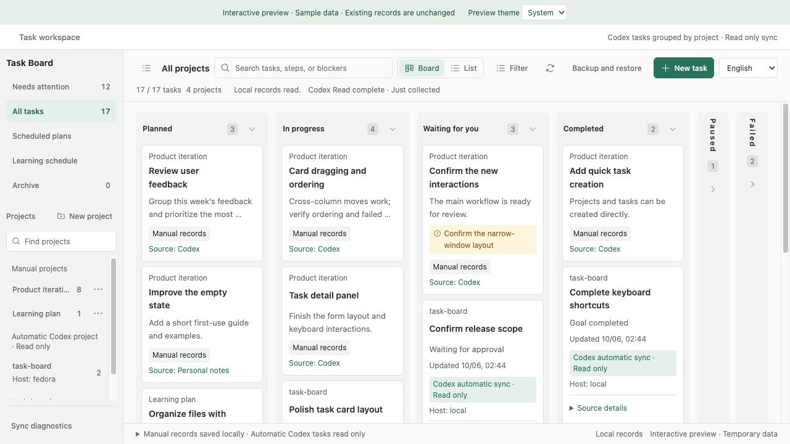

# Task Board

[简体中文](README.md) · English

A local task board inside Codex: track your projects, view Codex task snapshots, and plan learning sessions.



## Install

Currently targets **Codex desktop on macOS**, with plugin/MCP App support and **Node.js 22.13.0 or newer** on your PATH.

```sh
git clone https://github.com/lldynamics/codex-task-board.git
cd codex-task-board
npm ci --ignore-scripts
npm run build
codex plugin marketplace add .
codex plugin add codex-task-board@codex-task-board-local
```

Enable the plugin in Codex, then start a chat and ask **“Open Task Board.”** If your Codex build does not expose these plugin commands or MCP App panels, update to a supported build first. Installation does not enable a background collector.

## Use

- Create projects and tasks; use the board, list, or attention view. Open a task to read its full details or edit text fields.
- Change status or priority with a quick selector; it saves immediately and offers a field-specific undo. Full forms require **Save locally**.
- Ask Codex to record a task or update its status, current step, and blocker. It must read the board first and use the restricted task tool; archiving and backup restoration remain panel actions.
- Plan learning sessions with dates, time zones, objectives, and completion criteria. Session feedback does not automatically complete the whole task.
- Choose **中文 / English** in the interface. Your language choice is remembered; task contents, project names, paths, and IDs are kept as entered.
- Export a backup from **Backup & restore** before moving devices or upgrading an older prototype.

## Automatic collection and Codex usage

The visible panel reads **local snapshots and metadata every five seconds**. This read path does not start an additional model run. A snapshot stays fresh for two collection intervals plus one minute (between 3 and 35 minutes): with a 15-minute schedule, runtime states and approval/reply reminders stay current for about 31 minutes, after which they show as stale with an unknown state.

**Optional native scheduled collection runs Codex model work and uses your Codex allowance.** Model, context, reasoning, tools, and caching affect usage; there is no fixed per-collection token amount or price. A one-minute schedule can create many runs. Start with manual collection or a less frequent schedule, and check your account's usage.

To enable collection, ask Codex in a chat where the plugin is enabled:

> Configure a local native collection schedule for Task Board every 15 minutes. Before creating it, explain the model, frequency, and allowance usage, and wait for my confirmation. Each run should use the native task-list tool and save only Codex task metadata through `learning_board_codex_sync`, with the completed UTC capture time (if unsure of the current time, call learning_board_context after collecting and use its serverNow). Do not read conversation bodies, control tasks, or send messages to other chats. Report when the source is unavailable or incomplete. Stay quiet when there is no actionable change.

Creation and successful collection must be confirmed in Codex's result and schedule list. The plugin does not create this schedule during installation. The collection tool `learning_board_codex_sync` is visible to the model in every chat where the plugin is enabled; it writes only the separate status cache and never changes the manual board. Local scheduled work requires the computer to be awake and Codex running; it can queue or fail. Pause or remove the schedule in Codex to stop model runs—closing the board only stops the panel's polling.

This usage warning follows the official [scheduled-task execution model](https://learn.chatgpt.com/docs/automations#schedule-a-task-inside-a-chat) and [usage rules](https://learn.chatgpt.com/docs/pricing#what-are-the-usage-limits-for-my-plan); it is not a measurement of your account's per-run charge. The plugin's CLI can ingest an already collected JSON capture without starting a model; details are in the [developer guide](https://github.com/lldynamics/codex-task-board/blob/main/docs/development.md).

## Privacy and storage

- Manual records, backups, and the collection cache stay in `~/Library/Application Support/LearningBoard/`. This legacy path is intentionally retained to preserve existing data.
- The plugin does not upload records to a separate service or read Codex conversation bodies, prompts, or credentials. It reads a whitelist of local task metadata, including titles, states, hosts, paths, and timestamps.
- When you ask Codex to plan or record work, its tools return the relevant board records into the Codex conversation (reads omit archived records by default; writes return only the changed records). Native model collection likewise exposes authorized task metadata to Codex. Account data handling follows your Codex settings; “stored locally” does not mean model tools never see those records.
- Exported backups contain your task content, learning feedback, and links. Share them only when you intend to share that information.

## Troubleshooting

- **The plugin does not start**: Codex uses the `node` it finds. If that Node is older than 22.13.0, the server's startup log names the version and path it found; upgrade it or adjust the PATH Codex sees.
- **Another save is in progress**: try again shortly. If a process exited in the middle of a save, the next save detects and quarantines the leftover lock automatically.
- **The local record file cannot be read**: close every task board, then in the plugin directory run `node dist/maintenance.js list-backups` to pick a backup and `node dist/maintenance.js restore-backup <name> --confirm-all-clients-stopped`. The damaged file is kept, not deleted.
- **Times**: cards and the calendar use the display time zone you choose under learning sessions; it defaults to your computer's time zone.

## Compatibility and development

The plugin ID, npm package, and repository are **`codex-task-board`**, by **lldynamics**. The existing `learning_board_*` tools, backup format, and storage path remain compatibility interfaces. Enable only one of the old and new plugin identities. See the [compatibility guide](https://github.com/lldynamics/codex-task-board/blob/main/docs/compatibility.md).

Build, protocol, maintenance, and validation details are in [docs/development.md](https://github.com/lldynamics/codex-task-board/blob/main/docs/development.md). See the [CHANGELOG](https://github.com/lldynamics/codex-task-board/blob/main/CHANGELOG.md) for release changes; local preview artifacts are excluded from source control.

## License

[MIT](LICENSE) · Copyright © 2026 lldynamics. Bundled third-party licenses and notices are distributed with the plugin.
