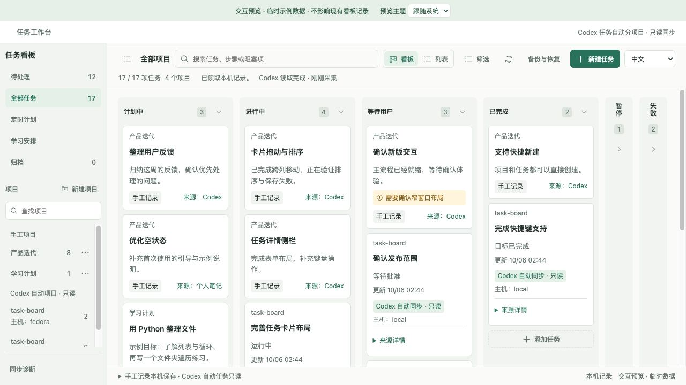

# 任务看板

简体中文 · [English](README.en.md)

在 Codex 里管理本机项目与任务，查看 Codex 任务快照，并安排具体的学习时段。



## 安装

目前面向 **macOS 版 Codex 桌面客户端**，需要插件 / MCP App 支持，以及可从 PATH 找到的 **Node.js 22.13.0 或更新版本**。

```sh
git clone https://github.com/lldynamics/codex-task-board.git
cd codex-task-board
npm ci --ignore-scripts
npm run build
codex plugin marketplace add .
codex plugin add codex-task-board@codex-task-board-local
```

在 Codex 中启用插件，再打开聊天说 **“打开任务看板”**。如果客户端没有这些插件命令或组件面板，先更新到支持的版本。安装不会自动开启后台采集。

## 怎么用

- 创建项目和任务，通过看板、列表或待处理视图查看；打开任务可阅读完整内容或编辑文字字段。
- 状态和优先级快捷选择会立即保存，并提供单字段撤销；完整表单需点击“保存到本机”。
- 可以在对话里让 Codex 记录普通任务，或更新状态、当前步骤和阻塞项。它先读取看板，再调用受限任务工具；归档和恢复备份仍通过面板操作。
- 学习安排保存日期、时区、目标和完成标准。完成一次学习时段，不会自动完成整个任务。
- 用界面的 **中文 / English** 切换语言，选择会保留。任务内容、项目名称、路径和 ID 保持原样。
- 升级旧原型或换电脑前，在“备份与恢复”中导出记录。

## 自动采集与 Codex 额度

面板可见时，默认**每 5 秒读取本地快照和元数据**。这个读取链路不会启动额外模型运行。快照在“两个采集间隔再加 1 分钟”内视为新鲜（3–35 分钟）：例如每 15 分钟采集一次，卡片的运行状态与“等待批准/回复”提醒保持约 31 分钟；超过后显示为过期、状态未知。

**另行启用原生定时采集后，会运行 Codex 模型任务并消耗你的使用额度。** 模型、上下文、推理、工具调用和缓存都会影响消耗，无法给出固定的每次 token 数或金额。每分钟调度可能产生大量运行；建议先手动采集，或从较低频率开始，并查看账号用量。

要开启采集，在启用了插件的 Codex 聊天中说：

> 请为任务看板配置每 15 分钟执行的本机原生定时采集。创建前告诉我模型、频率和会占用 Codex 额度，等我确认。每次使用原生任务列表工具，只将 Codex 任务元数据通过 learning_board_codex_sync 保存，附上采集完成的 UTC 时间（不确定当前时间时，采集后调用 learning_board_context 并使用其 serverNow）。不要读取对话正文、控制任务或向其他聊天发消息。来源不可用或不完整时明确报告；没有需要处理的变化时保持安静。

以 Codex 的创建结果、计划列表和成功采集时间为准。采集工具 `learning_board_codex_sync` 在所有启用插件的对话中都对模型可见，只会写入独立的状态缓存，不改动手工看板。插件安装时不会创建这项计划。本机定时任务需要电脑保持唤醒且 Codex 运行，也可能排队或失败。要停止模型运行，在 Codex 定时任务里暂停或删除计划；关闭看板只会停止页面轮询。

额度说明依据官方[定时任务执行方式](https://learn.chatgpt.com/docs/automations#schedule-a-task-inside-a-chat)与[用量规则](https://learn.chatgpt.com/docs/pricing#what-are-the-usage-limits-for-my-plan)，不是对你账号单次扣费的实测。插件 CLI 可导入已经采集的 JSON，不会自行启动模型，详见[开发文档](https://github.com/lldynamics/codex-task-board/blob/main/docs/development.md)。

## 隐私与数据

- 手工记录、备份和采集缓存保存在 `~/Library/Application Support/LearningBoard/`；这个旧路径有意保留，以兼容已有数据。
- 插件不向独立服务上传记录，也不读取 Codex 对话正文、提示词或凭据；仅按白名单读取任务标题、状态、主机、路径和时间等本机元数据。
- 当你让 Codex 规划或记录任务时，相关看板记录会经工具进入 Codex 对话上下文（读取时默认省略已归档记录，写入后只返回本次变更的记录）；原生模型采集也会把已授权的任务元数据提供给 Codex。账号的数据处理遵循你的 Codex 设置，“本机保存”不代表模型工具永远看不到这些记录。
- 导出的备份包含任务内容、学习反馈和链接，分享前请确认其中的信息。

## 常见问题

- **插件无法启动**：Codex 会使用它找到的 `node`。若版本低于 22.13.0，服务会在启动日志中说明找到的版本和路径；请升级该 Node 或调整 Codex 可见的 PATH。
- **提示另一处正在保存**：稍后重试即可。保存时若进程异常退出，下一次保存会自动识别并隔离遗留的锁，无需手动处理。
- **本机记录文件无法读取**：关闭所有任务看板后，在插件目录运行 `node dist/maintenance.js list-backups` 选择备份，再运行 `node dist/maintenance.js restore-backup <备份名> --confirm-all-clients-stopped`。损坏的文件会另存，不会删除。
- **时间显示**：卡片和日历按你在学习安排中选择的显示时区显示，默认跟随本机时区。

## 兼容与开发

插件 ID、npm 包名与仓库名统一为 **`codex-task-board`**，开发者为 **lldynamics**。已有 `learning_board_*` 工具、备份格式和数据目录继续作为兼容接口。旧、新插件只启用一份，详见[兼容说明](https://github.com/lldynamics/codex-task-board/blob/main/docs/compatibility.md)。

构建、协议、维护与验证细节移至 [docs/development.md](https://github.com/lldynamics/codex-task-board/blob/main/docs/development.md)，版本变更见 [CHANGELOG](https://github.com/lldynamics/codex-task-board/blob/main/CHANGELOG.md)。本机预览产物不进入版本控制。

## 许可证

[MIT](LICENSE) · Copyright © 2026 lldynamics。插件随附第三方依赖的许可证和声明。
